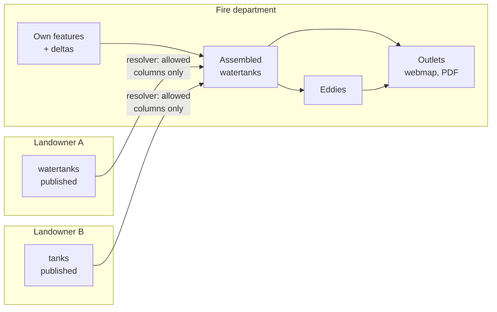
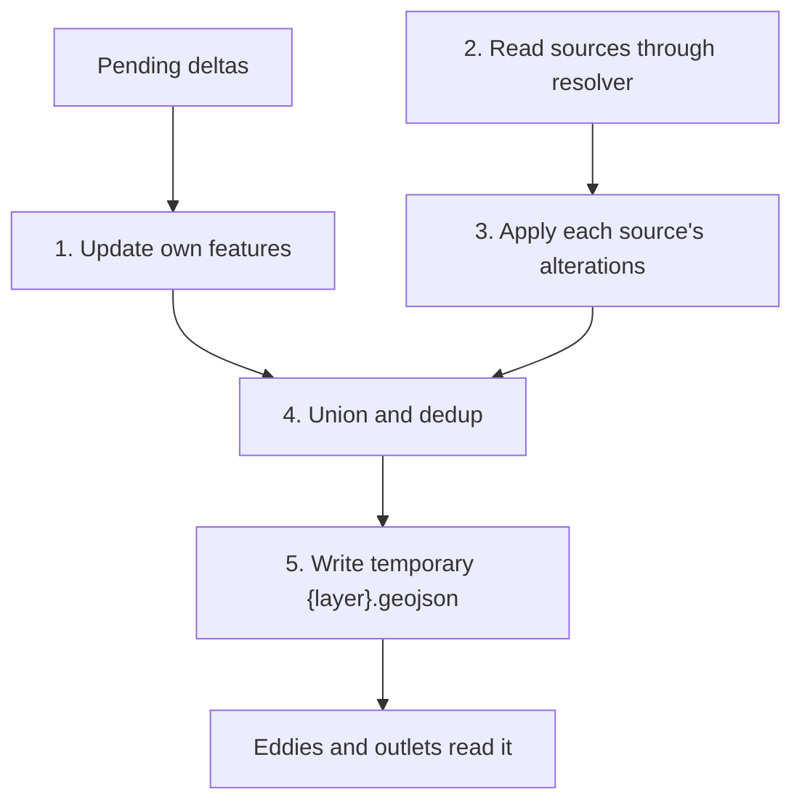
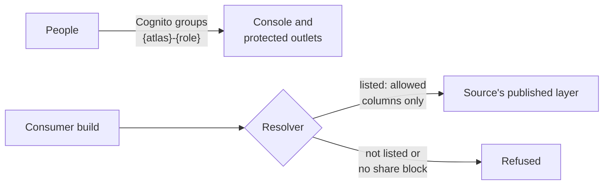
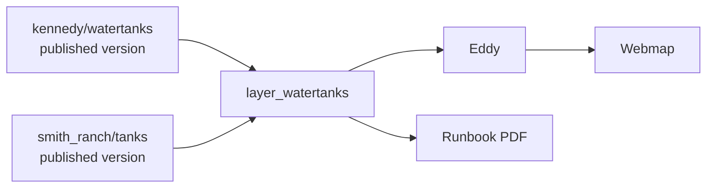

# Federation v2: Design Overview

**Status:** design only, nothing built. Assumes the cloud migration is finished. Simplified on purpose; this is not an implementation spec.

## The idea

A consumer atlas references data in other atlases instead of copying it in.

- **One layer, many sources.** A fire department gets one `watertanks` layer, not one layer per landowner.
- **Authority stays with the source.** The consumer stores a reference. Only its outlets contain a copy.
- **Sources are read at build time.** Each build reads the source's latest published version.

v1 pulled data in through an inlet and stored a copy. v2 replaces that.



## Configuration

Both sides opt in. Settings sit on the layer entry and are edited in the console's Edit Layer form with dropdowns and checkboxes.

```json
"watertanks": {
  "layer_def": "watertanks",
  "share": {
    "with": ["scvfd"],
    "max_access": "internal",
    "columns": ["name", "capacity"]
  },
  "federate": [
    {"atlas": "kennedy", "layer": "watertanks"},
    {"atlas": "smith_ranch", "layer": "tanks",
     "alterations": {"canonicalize": [{"from": ["gallons"], "to": "capacity"}]}}
  ]
}
```

- **`share`** is what this atlas offers. `with` can be `"*"` for any atlas we host. Columns are an allowlist, so new columns stay private until ticked.
- **`federate`** is what this atlas reads. The dropdown lists only what has been shared with it.
- **Compatibility:** sources with the same `layer_def` combine directly. Otherwise add `alterations` to the source entry. This is the same block inlets use, run by the same `utils.alter_features` (`canonicalize`, `filter`, `vector_width`). The form may offer only rename at first, but nothing assumes a block is rename-only (#220).

The "With" list shows only atlases that overlap yours.

## How a layer is built

A layer's own features move to `{layer}.own.geojson`. The normal `{layer}.geojson` becomes a temporary assembled file, so existing eddies and outlets don't change. Layers without `federate` work as they do today.



- **Order:** alterations run after the resolver, on columns it has already filtered and under the source's column names. Run earlier, an alteration could copy a withheld column into an allowed name.
- **Session:** assembly happens in the session workspace, and the assembled file is never written back to S3.
- **Dedup:** points only at first. Sources are ranked, and a lower-ranked point within a set distance is dropped.
- **Tagging:** each feature records its source and origin.

## Edits and publishing

| Action | Effect |
|---|---|
| Source edits a feature | Stays in the source's staging |
| Source runs New Version | Edits and share settings become visible to consumers |
| Consumer edits its own features | Normal delta flow |
| Consumer edits a federated feature | Visibly rejected; corrections go to the source |
| Consumer rebuilds | Picks up the source's latest published version |
| Consumer runs New Version | Stores own features and links to the source versions used |

There is no separate publish for sharing. All share changes, including turning sharing off, wait for the source's next New Version. The form should show when a saved change is unpublished.

Consumers are not rebuilt automatically. The console shows a notice when a source has a newer version. The check is passive: when the console loads, it compares the source versions recorded at the last New Version with each source's catalog. Nothing polls. The notice arrives through the console's status snapshot (#219). Revoking a share affects future builds only, so existing outlets keep the data until rebuilt, and printed PDFs can't be recalled.

## Access control



- **People:** Cognito groups, as already planned. Only `{atlas}-admin` can change settings.
- **Atlases:** the resolver is the only way to read another atlas. It reads the share settings stored with that published version and removes withheld columns before anything reaches the workspace.
- **Consumer access limit:** a federated layer takes the most restrictive `max_access` of its sources, so one internal-only source keeps the whole layer off public outlets.

This relies on one function, so it needs thorough tests. These include one proving that a withheld column never reaches the assembled layer, even through an alteration.

## Dependencies

Each source becomes an upstream node in the consumer's asset graph. Existing `in_layer` edges then carry staleness across atlases.



The graph reports what is stale. In v2 it drives the notice and doesn't trigger rebuilds. Eddies read the combined layer, so federating `roads` changes road mileage. Their results are stored in the consumer's atlas and need a rerun after a revocation.

## Scope

**In v2:** vector layers, many sources per layer, column filtering, per-source alterations, access limits, point dedup, stale notices and Edit Layer UI.

**Not in v2:** rasters, consumer-side changes, chains, automatic rebuilds and sources hosted elsewhere.

Chains aren't prohibited. v2 shares own features because that's simplest, and nothing rejects a chain config.

## Open issues and options

**Prerequisites**
- **Editable config post-cloud (#195):** admin edits need to persist outside the immutable Lambda image.
- **Access defaults (#175, #176):** `access` should fail closed, and `sqldb` shouldn't pull federated data into `atlas.db` regardless of tier.
- **Graph gaps (#202):** `lrs_zones_layer` isn't a graph edge. `game_kit` also reads roads through `roles`, which the graph can't see, and has no issue yet.
- **Cross-atlas graph edges:** these don't exist yet.

**To revisit**
- **Mixed access:** one internal-only source pulling a whole layer off public maps may prove too blunt. The alternative is filtering per source by audience.
- **Consumer corrections:** hide or correct a federated feature with replayed deltas. This belongs in the wider delta rethink (#200).
- **Chains:** the real question is whether consent passes along the chain.
- **Automatic rebuilds:** cheap outlets could rebuild from the graph, but not PDFs and not publishes.
- **Scoped IAM credentials:** a second layer of protection behind the resolver.
- **Outside readers:** sources or consumers hosted elsewhere would need a filtered copy.
- **Deeper dedup:** attribute-aware points (#217), lines and polygons (#218).
- **Rename leaves the original:** `canonicalize` copies a value and keeps the source key, so `gallons` survives next to `capacity`. Options are a `REMOVE` entry or a `move` option (#220).
- **One bbox rule:** `s3_geojson` and `federation_inlet` clip differently, and the resolver needs one rule (#221).
- **Rasters:** `cog_url` already shares by reference. Combining sources would be a mosaic problem.

**Not yet worked through**
- **Liability and attribution:** who is responsible for bad data on a fire map. At minimum, show each source and its data date in popups and PDFs.
- **Schema drift:** a source renames a column and a `canonicalize` entry silently stops matching. Have `alter_features` report `from` keys that match nothing, which helps inlets too, and show that as a console notice (#219).
- **Source deletion:** cleanup of old versions must respect links from other atlases.
- **Feature IDs:** #200 reports that rebuilds give inlet-fed features new `atlas_id`s, which matters for anything that references them.
- **Rehearsal:** test on staging with two sources, a revocation and a withheld column.
