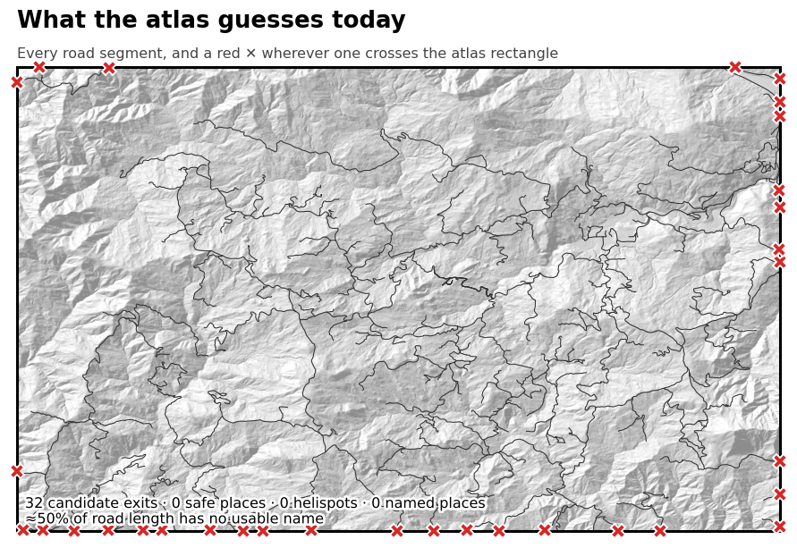
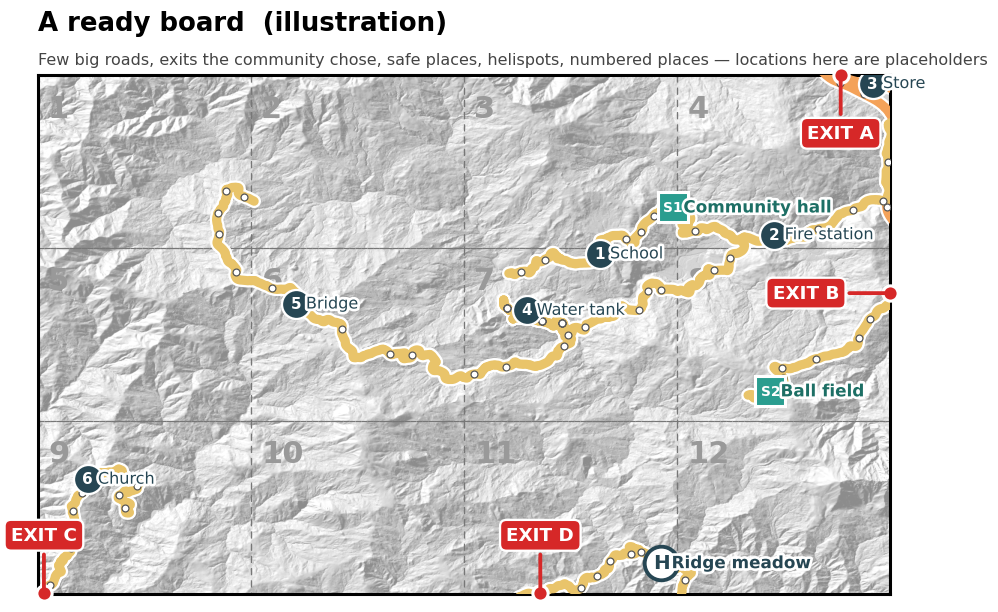
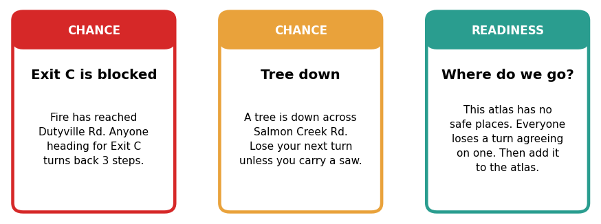

# The Local Wildfire Game

*A board game about evacuating your own community, made from your atlas. The point is less the game than everything a community has to agree on before it can be played.*

UC Davis's [Wildfire Resilience DIY game kit](https://prototypingresilience.com/diy-game-kit) is a tabletop game. One player is the Fire; the others are neighbors trying to get their households out. The kit gives you the rules, spinners and generic chance cards. Each community supplies its own map and a few local cards. The `game_kit` outlet makes that local part from what the atlas already holds:

- a 36×24 inch printable board;
- a sheet of local chance cards;
- a **readiness check**.

## The readiness check is the point

A board needs a handful of things to be playable:

- ways out;
- places to go;
- somewhere a helicopter can land;
- named places for the cards to point at;
- roads that have names.

Those are the same things a community needs to have worked out *before* a fire. So the first thing the outlet produces is a check of what the atlas is missing.

| Ingredient | Why the game needs it | Why the community needs it |
|---|---|---|
| **Exits** (at least 2) | Players win by reaching one | Everyone should know their two ways out |
| **Safe places** | The evacuation order has to send people somewhere | Same, for real |
| **Helispots** | "Air support" cards | Crews and medevac need known landing zones |
| **Named places** (at least 6) | "Your loved one is at ⑰" cards | Shared landmarks make radio and phone directions work |
| **Road names** | Cards say *which* road is blocked | Dispatch, alerts and neighbors need the same names |
| **Hazards** | Local "one-lane bridge" cards | Known choke points on the way out |
| **Alert system** | The setup sheet's sign-up line | People have to be signed up before the night it matters |

Run on Salmon Creek (SCVFD), the check found that the atlas, built mostly from public road data, is short on exactly these:

- **32 "exits"**: every road that crosses the edge of the atlas rectangle. Most are logging spurs and driveways that happen to touch an arbitrary boundary, not ways out.
- **No safe places, no helispots and no named places.**
- **About half the road length has no usable name.** Segments are blank, a bare "DR", or a number.

### Stop guessing; make it explicit

Today the outlet *guesses* at exits: it ranks highways first, then longer roads. That is enough to draw a board, but it is the wrong answer to keep. Whether a road is a real way out depends on things a road dataset doesn't hold:

- whether it is gated;
- whether a fire engine can get through it;
- whether it leads somewhere safer, or just to the next drainage.

The guess should be a starting point for a conversation, not a result. The atlas should carry the community's answer as data:

- **an `exits` layer** of points where agreed evacuation routes leave the area, each with its route name, notes ("gated: key at the fire station") and who confirmed it;
- **`safe_places` and `helispots` layers**, each with capacity, access notes and a confirmed date;
- **a `landmarks` layer** of the places people actually give directions by;
- **road-name cleanup** done as deltas on the roads layer, so the names stick across rebuilds.

When those layers exist, the outlet uses them as they are. The algorithm's candidates are shown only as "is this one an exit?" prompts for the people filling the layers in. *(This is the proposed next step; the current outlet still guesses exits from roads.)*

## Getting past the check

The work is a few meetings, not a software project.

1. **Print the check and the candidate map.** Bring the "today" board, with its 32 crosses, to a fire department or fire safe council meeting.
2. **Walk the edges.** For each cross, someone who knows the road says yes, no, or "only in a pickup". The yeses become the `exits` layer, drawn in the console.
3. **Name the places.** Agree on the community hall, the school, the store, the ball field. Mark which are safe places and which open ground could take a helicopter. Hand those to the fire department to confirm.
4. **Fix names where you meet them.** The board prints only named roads. Every gap that someone notices ("that's Pine Dr, everyone knows that") is a one-line edit.
5. **Re-run the kit.** Each fix turns a ✗ into a ✓, and the board fills in.

The result is a better atlas: a map the volunteer fire department, the fire safe council and the county can all use, whether or not anyone plays the game.

*Illustration only. The roads and exits come from SCVFD's data, but the safe places, helispot and numbered places are placeholders, not a plan.*

## Playing it with neighbors

Once the board is ready, play it. A game takes an evening around a kitchen table or at a grange hall, and it does several things a meeting can't:

- **Neighbors rehearse their own exits.** Racing the Fire to Exit C makes people find out, out loud, that they had never thought about Exit C.
- **The cards are their roads.** "Tree down across Salmon Creek Rd" lands differently when it's the road you drive every day.
- **It surfaces gaps the atlas still has.** Some cards exist only *because* something is missing. "Where do we go?" is in the deck until the atlas has a safe place. Every game ends with a short list of things to add.
- **It introduces people.** The point of a community game is partly the community: who lives up the ridge, who has a water tank, who can't drive.

So the loop runs **atlas → readiness check → community fixes → game → new gaps → atlas**. It works the same way for any atlas, and it gives a fire safe council something concrete to do with one.

## Status

- The `game_kit` outlet is on branch `feature/game-kit`. It covers the board PDF, the local cards and the readiness page (`python/game_kit.py`, `python/outlets_game_kit.py`); the asset's `roles` setting maps layers to game roles.
- SCVFD is the first atlas wired up, admin-only because it prints names from admin layers.
- **Next:**
  - explicit `exits`, `safe_places`, `helispots` and `landmarks` layers for SCVFD;
  - the outlet reading those in preference to its guesses;
  - an alert-system line for the setup sheet.
- **Later:** road-network checks, such as neighborhoods with only one way out, or a single bridge every route depends on.

The game, its rules and its artwork belong to the UC Davis [Prototyping Resilience](https://prototypingresilience.com/diy-game-kit) project. The outlet only links to their kit and adds local pieces. The figures here are made by `images/game_kit/make_figures.py` from SCVFD staging data.
